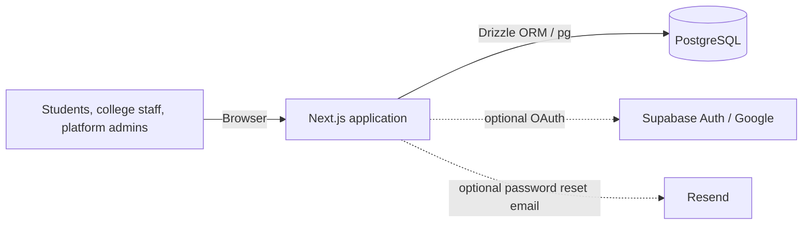
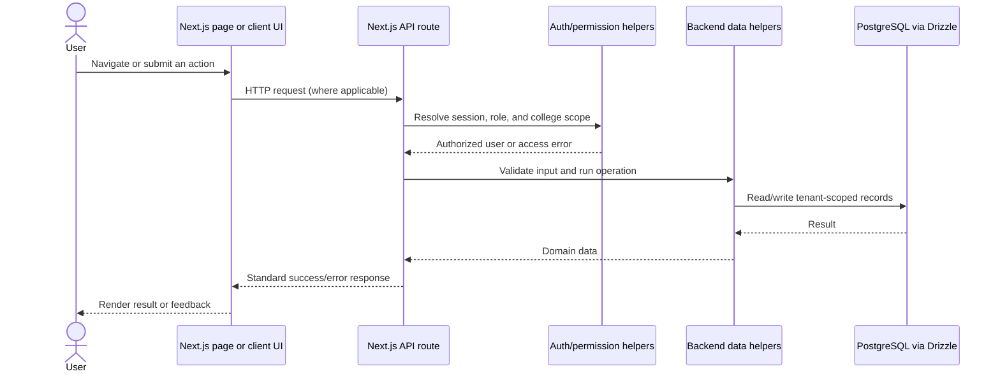

# EduSphere architecture

## 1. Overview

EduSphere is a single Next.js application with server-rendered portal pages, client-side interactive components, and API route handlers in the same deployment. Business logic, authorization helpers, and the relational schema are organized under `src/backend`; PostgreSQL is accessed with Drizzle ORM and the `pg` driver.

This is a modular monolith, not a separately deployed frontend and backend. Next.js route entry points remain under `src/app`.

## 2. System context



The Supabase integration is used to initiate and complete the optional Google OAuth flow. After OAuth verification, the callback looks up the application account and issues the application's normal session cookie; Supabase is not the primary store for application roles or academic records.

## 3. Technology stack

| Area | Technology |
| --- | --- |
| Application and routing | Next.js 16 App Router |
| UI | React 19, TypeScript, Tailwind CSS |
| Relational database | PostgreSQL |
| Database access/schema | `pg` and Drizzle ORM |
| Request validation | Zod |
| Optional Google OAuth | Supabase Auth with `@supabase/ssr` |
| Optional email delivery | Resend REST API |
| PDF/CSV support | Application utilities under `src/backend/lib` |

## 4. Repository layout

```text
src/
  app/
    (portal-login)/       # Portal-specific login pages
    admin/                # Platform administrator pages, including global notices
    college/              # College operations pages
    student/              # Student self-service pages
    api/v1/                # Versioned REST-style route handlers
    auth/callback/         # Supabase OAuth callback
  backend/
    db/
      index.ts             # PostgreSQL pool and Drizzle instance
      schema.ts            # Tables, enums, indexes, and types
      seed.ts               # Initial/demo data setup
    lib/
      api*.ts               # API response, auth, and error helpers
      auth.ts               # Session cookie and account lookup
      permissions.ts        # Shared role and scope rules
      data.ts               # Shared domain data access/helpers
      validations.ts        # Zod request validation
      audit.ts              # Audit logging
      documents.ts          # File/document operations
      mail.ts, pdf.ts, csv.ts
  frontend/
    components/             # Shared portal and interface components
```

The exact set of route pages and API endpoints is visible under `src/app`; pages and API handlers share one application and deployment.

## 5. Application layers and request flow

### Frontend

- Next.js App Router pages render the admin, college, and student portals.
- Reusable components under `src/frontend/components` provide shared portal navigation, login frames, and other UI.
- Interactive elements use React client components where browser state or navigation is needed.
- Protected page layouts resolve the current user on the server and apply the relevant portal guard before rendering.

### API and domain logic

- API route handlers live under `src/app/api/v1`.
- Routes are grouped by `auth`, `admin`, `college`, `student`, and shared resources such as notices and uploads.
- Route handlers use shared helpers for authentication, role requirements, college scope, request validation, pagination, and response formatting.
- Domain queries and reusable operations are implemented under `src/backend/lib`, rather than treating client-side controls as security boundaries.

### Data access

- `src/backend/db/index.ts` creates a PostgreSQL connection pool and exports the Drizzle database client.
- `src/backend/db/schema.ts` defines the typed relational schema, enums, foreign keys, and indexes.
- Server-side helpers and handlers access PostgreSQL through Drizzle.
- Database configuration is read from `DATABASE_URL`; the application fails at startup if it is missing.

Typical request flow:



## 6. Authentication and authorization

### Application sessions

- Password-based authentication is handled by the application's auth routes and user records.
- Successful login issues an HTTP-only `cms_session` cookie. It is `SameSite=Lax`, uses `Secure` in production, and has a 12-hour maximum age.
- The signed token identifies the user; protected requests reload the current user and roles from PostgreSQL, and reject inactive accounts.
- A session epoch is checked against the database to support invalidating older sessions.
- Password reset uses persisted, expiring, single-use reset tokens.

### Google OAuth

- Browser and server Supabase clients are created only when `NEXT_PUBLIC_SUPABASE_URL` and `NEXT_PUBLIC_SUPABASE_ANON_KEY` are configured.
- The OAuth callback exchanges the code with Supabase, validates the provider/email, and matches an existing application account.
- OAuth does not by itself create an application user or assign a role. A verified email may be carried into registration through a short-lived signed cookie.

### Role and tenant boundaries

| Role | Scope and principal capabilities |
| --- | --- |
| `platform_admin` | Platform-wide college, user, audit, report, and settings operations. |
| `college_admin` | Assigned-college operations, student record management, academic administration, result publication, notices, and settings. |
| `faculty` | Assigned-college academic operations; faculty-only workflows are constrained to taught offerings where implemented. |
| `accounts_staff` | Assigned-college fee management and permitted student information. |
| `student` | The signed-in student's own profile and academic/fee information. |

Authorization is represented in shared helpers in `src/backend/lib/permissions.ts` and enforced by server page/API guards. API helpers reject unauthenticated requests, disallowed roles, missing college assignments, and requests to another college. College accounts are additionally blocked from protected college operations until the college is active. College notices are stored with their college ID. Platform-admin notices use a null college ID and are managed separately at `/admin/notices`; student-facing notice queries combine published notices for the student's own college with published platform-wide notices, subject to audience filtering.

## 7. Data model

The schema is relational and centers on college tenants and user roles.

| Domain | Main records |
| --- | --- |
| Identity and access | `users`, `user_roles`, `password_reset_tokens` |
| Tenant structure | `colleges`, `departments`, `programs` |
| People | `students`, `faculty_profiles` |
| Curriculum | `courses`, `course_offerings`, `course_enrollments`, `timetable_entries` |
| Attendance | `attendance_sessions`, `attendance_records` |
| Assessment | `assessments`, `results` |
| Finance | `fee_invoices`, `fee_transactions` |
| Communication and files | `notices`, `file_uploads` |
| Governance/configuration | `audit_logs`, `platform_settings` |

Foreign keys, enum columns, and unique indexes protect important relationships and prevent duplicate entities such as a student's registration number within a college, an enrollment in the same offering, or a result for the same assessment/student pair. Data access must still apply tenant and role constraints; relational constraints alone do not provide authorization.

Uploads are stored as PostgreSQL binary data in `file_uploads`, alongside metadata and college ownership.

## 8. API conventions

- Base path: `/api/v1`.
- Main route groups: `/auth/*`, `/admin/*` (including platform-wide notices), `/college/*`, `/student/*`, plus shared `/notices` and `/uploads/*`.
- Health endpoint: `/api/health`.
- Successful responses use `{ "data": ..., "meta": ... }`; list endpoints may include pagination fields in `meta`.
- Errors use `{ "error": { "code": "...", "message": "...", "details": [...] } }` where details apply.
- Zod validation failures are returned as validation errors; authentication and authorization failures use appropriate HTTP status codes.

## 9. Integrations and configuration

| Variable | Required | Purpose |
| --- | --- | --- |
| `DATABASE_URL` | Yes | PostgreSQL connection string. |
| `SESSION_SECRET` | Yes | Signs application session and other signed tokens. |
| `APP_URL` | Optional | Public application URL used when constructing reset links. |
| `RESEND_API_KEY` | Optional | Enables password reset email delivery through Resend. |
| `MAIL_FROM` | Optional | Sender address for reset email. |
| `NEXT_PUBLIC_SUPABASE_URL` | Optional | Supabase project URL for Google OAuth. |
| `NEXT_PUBLIC_SUPABASE_ANON_KEY` | Optional | Public Supabase key used by browser/server OAuth clients. |

The Supabase service-role key must not be used by browser code. When email delivery is not configured, reset email is not delivered; local development may log a reset link for testing.

## 10. Setup, seed, and deployment model

- Install dependencies with `npm install`.
- Set required environment variables and provide a PostgreSQL database.
- Apply the Drizzle schema using the repository's documented `npx drizzle-kit push` workflow.
- Initial demo data is seeded on first request only in development and only when the user table is empty. Production requests never seed demo accounts; provision a production administrator through a controlled setup process. The student data helper can synchronize enrollments for matching active offerings.
- Run locally with `npm run dev`; production uses `npm run build` and `npm run start`.
- Deploy the Next.js application and PostgreSQL database as managed services appropriate to the deployment environment.

The repository uses Drizzle Kit schema push configuration; do not assume a checked-in, versioned migration workflow unless one is added.

## 11. Testing and quality checks

- Permission logic has focused Node tests in `src/backend/lib/permissions.test.ts`.
- Run the repository's test command for that file: `node --experimental-strip-types --test src/backend/lib/permissions.test.ts`.
- Run `npm run lint`, `npm run typecheck`, and `npm run build` for broader static and production-build checks.
- Add tests for authorization boundaries and core data workflows when extending protected routes.

## 12. Operational constraints and production considerations

These are implementation constraints to account for, not guarantees:

- The included rate limiter uses in-memory process state; it is not shared across instances and resets when a process restarts. A multi-instance deployment needs a shared rate-limit store.
- File bytes live in PostgreSQL, which simplifies the prototype but can increase database size and backup/restore costs. Evaluate object storage and retention policies before large-scale use.
- Application-level request logs and audit records do not constitute a complete monitoring/alerting platform. Define production observability, incident response, and audit retention.
- Configure and verify PostgreSQL backups, restore procedures, connection limits, secrets management, and TLS in the target environment.
- Define deployment-specific privacy, retention, data residency, and institutional compliance requirements before handling production student records.
- Define and test expected availability, latency, throughput, and data-recovery targets; none are currently specified in the repository.
